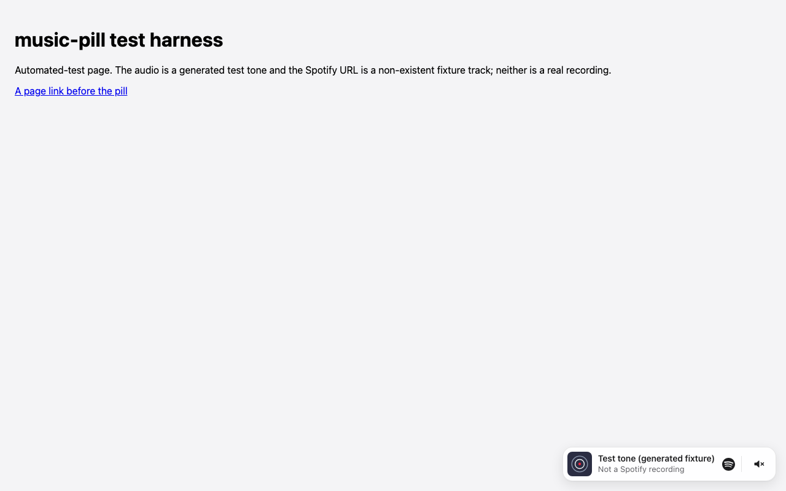
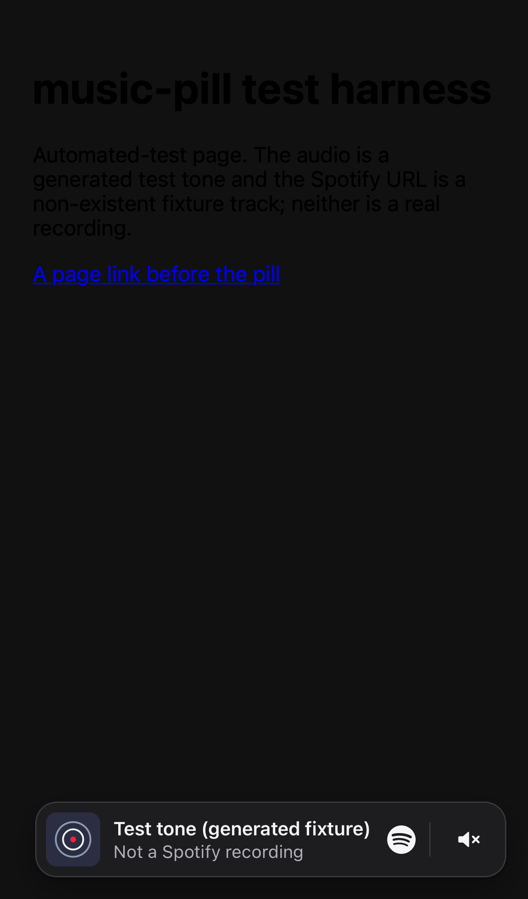
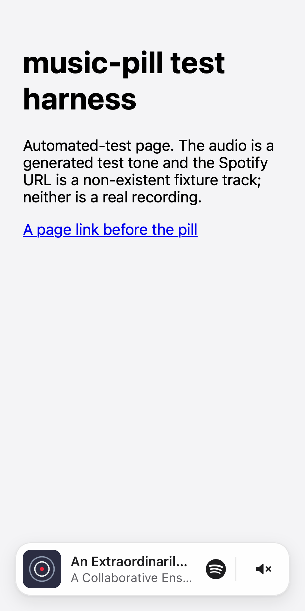

# music-pill

A small, framework-independent web component: a fixed "now playing" style pill
that **links to a song on Spotify**, with optional background audio that
**you host and are licensed to play**, which fades in, loops, and fades out.



 

- Native custom element, open Shadow DOM, vanilla TypeScript, **zero runtime dependencies** (~10 kB gzipped).
- One script plus one tag. Works in plain HTML and in any framework.
- No Spotify login, API key, backend or proxy is needed.
- Six positions, three sizes, auto/light/dark themes, CSS custom properties, and `::part()` hooks.

> **Two separate things.** `spotify-url` is where the pill *links to*. It
> is never fetched or played. `audio-src` is an *optional, separate* audio
> file that you host and have the rights to play on a website. Linking to
> Spotify grants no audio or artwork rights.

> **Status:** v0.1.0, not yet published to npm. Installation examples below use
> placeholders. The working path today is building the repo and using the
> files in `dist/`.

---

## Quick start

```sh
git clone https://github.com/griffinvelichko/music-pill.git
cd music-pill
npm ci
npm run build          # -> dist/auto.js (self-contained module)
npm run playground     # serves and opens http://127.0.0.1:4391/playground/
```

Copy `dist/auto.js` into your site (for example to `/vendor/music-pill/auto.js`), then:

```html
<script type="module" src="/vendor/music-pill/auto.js"></script>

<music-pill
  spotify-url="https://open.spotify.com/track/TRACK_ID"
  song-title="Song title"
  artist="Artist name"
  artwork="/images/album.jpg"
></music-pill>
```

`TRACK_ID` and the image path are placeholders; use your own values. The
smallest valid tag is:

```html
<music-pill spotify-url="https://open.spotify.com/track/TRACK_ID"></music-pill>
```

That renders a generic **"Listen on Spotify"** link with a neutral artwork
placeholder. A Spotify link alone cannot supply a title, artist, artwork or
audio: the component never calls Spotify at runtime, so anything you want shown
must be in the attributes. See [Metadata](#metadata) for an optional helper that
fills in the title and artwork for you.

A runnable local example lives in [`examples/plain-html/`](examples/plain-html/index.html)
(`npm run build && npm run serve`, then open `http://127.0.0.1:4391/examples/plain-html/`).

### After publication (placeholders)

The package name `music-pill` is a working name and may not be available on npm.

```sh
npm install <package-name>@<version>
```

```html
<!-- self-hosted copy of dist/auto.js (recommended), or a pinned CDN URL once one exists -->
<script type="module" src="https://<cdn-host>/<package-name>@<version>/dist/auto.js"></script>
```

---

## Link-only vs. licensed audio

| Setup | What the visitor gets |
| --- | --- |
| `spotify-url` (+ optional metadata) | A link pill. **No audio work at all**, no sound button, and nothing implies that music is playing. |
| `spotify-url` + `audio-src` | The same link pill, plus background audio that fades and loops, and a separate sound on/off button. |

```html
<music-pill
  spotify-url="https://open.spotify.com/track/TRACK_ID"
  song-title="Song title"
  artist="Artist name"
  artwork="/images/album.jpg"
  audio-src="/audio/licensed-song.mp3"
  theme="dark"
  size="md"
  position="bottom-right"
  autoplay="attempt"
></music-pill>
```

When you use `audio-src`:

- It must be audio you're allowed to play publicly on a website: you own it, or you hold a licence that covers it. A Spotify link grants no such right, and **Spotify does not grant general website soundtrack rights**.
- It must be **the same recording** that the Spotify link and the title/artist describe. Never play unrelated audio under a Spotify song's label.
- Do not use ripped Spotify audio, Spotify preview URLs, or the Spotify Web Playback SDK as a background-audio source. None of these are supported, and they are not permitted for this purpose.

---

## Attributes

| Attribute | Values | Default |
| --- | --- | --- |
| `spotify-url` | **Required.** `https://open.spotify.com/track/<22-char id>` (`?si=` and `/intl-xx/` are stripped), or a `spotify:track:<id>` URI, which is normalised. Anything else hides the pill and emits `music-pill-error`. | none |
| `song-title`, `artist` | Plain text. It is rendered as text, never as HTML. Control/bidi-override characters are stripped and it is capped at 200 characters. | none |
| `artwork` | Image URL (`http(s)`, relative, `blob:`, or `data:image/…`). A broken image falls back to a neutral placeholder. | placeholder |
| `audio-src` | Audio URL (`http(s)`, relative, `blob:`, or `data:audio/…`). If omitted, no audio work happens and there is no sound button. | none |
| `position` | `top-left` `top-center` `top-right` `bottom-left` `bottom-center` `bottom-right` | `bottom-right` |
| `size` | `sm` (48 px) `md` (56 px) `lg` (64 px) | `md` |
| `theme` | `auto` `light` `dark` | `auto` |
| `autoplay` | `attempt` or `off`. This is an **enumerated string**, not an HTML boolean: a bare `autoplay` or `autoplay="false"` means the default, `attempt`. | `attempt` (when `audio-src` is set) |
| `volume` | `0`–`1`. Values are clamped and junk is ignored. This is the gain the fade reaches. | `0.25` |
| `fade-duration` | Seconds, clamped to `0`–`10`, and further clamped at runtime so fade-in and fade-out never overlap within a short track. | `1.5` |
| `sound-control` | `built-in` or `host`. See [Sound control](#sound-control). | `built-in` |

Live changes: `position`, `size`, `theme`, `volume`, `fade-duration` and the
metadata attributes update the existing pill **without restarting audio**.
Changing `audio-src` or `spotify-url` is a song change. It stops and releases
the old audio, cancels all of its pending work, and starts fresh. `autoplay` is
read when a song loads.

---

## Metadata

**Explicit attributes are authoritative**, and they are the reliable,
zero-backend path. Write the title, artist and artwork yourself.

To fill them in faster, use the optional resolver. It calls Spotify's
documented [oEmbed endpoint](https://developer.spotify.com/documentation/embeds/tutorials/using-the-oembed-api)
**at build time or on your machine**, not on every page view:

```sh
npm run build
node bin/music-pill-resolve.mjs "https://open.spotify.com/track/TRACK_ID" --artist "Artist name"
# after installing the package: npx music-pill-resolve <url> --artist "..."
```

It prints a ready-to-paste tag:

```html
<!-- artwork is Spotify-provided: keep the built-in Spotify attribution and link. -->
<music-pill
  spotify-url="https://open.spotify.com/track/TRACK_ID"
  song-title="Title from oEmbed"
  artist="Artist name"
  artwork="https://image-cdn-….spotifycdn.com/image/…"
></music-pill>
```

The resolver keeps to what oEmbed actually documents:

- It uses only oEmbed's `title` and `thumbnail_url` (plus dimensions). oEmbed has **no separate artist field**, so the artist is always yours to type. The publisher is not treated as the artist, and the title string is never parsed for one.
- oEmbed returns **no audio URL**, and the resolver never looks for one.
- The returned iframe `html` is ignored and never injected anywhere.
- A network error, CORS block or unknown track is a normal outcome: you get `status: "unavailable"` and the link-only snippet.

It is also available programmatically (Node 18+ or browsers):

```js
import { resolveSpotifyMetadata, toMusicPillSnippet } from '<package-name>/resolve';
const meta = await resolveSpotifyMetadata('spotify:track:TRACK_ID');
console.log(toMusicPillSnippet(meta, { artist: 'Artist name' }));
```

A future authenticated Spotify Web API adapter (for richer metadata) is possible
but out of scope for v1. It would need credentials and a backend.

---

## Autoplay outcomes

Audible autoplay is **a best-effort attempt, never a guarantee**. Browsers
(Chrome, Safari/WebKit, Firefox, and especially iOS) commonly block sound for
new visitors until they interact with the site.

With `autoplay="attempt"`, the component makes **one** startup attempt:

| Outcome | `playbackState` | Event |
| --- | --- | --- |
| Browser allows it, the media plays and the Web Audio graph runs | `playing` (fades in) | `music-pill-statechange` |
| `play()` rejected (`NotAllowedError`) | `blocked` | `music-pill-autoplay-blocked` `{ reason: "play-rejected" }` |
| Media "plays" but the `AudioContext` stays suspended, so nothing would be heard | `blocked` | `music-pill-autoplay-blocked` `{ reason: "context-suspended" }` |
| Visitor muted earlier in this session | `muted` | none (no attempt is made) |
| Another pill on the page already holds the audio slot | `idle` | none |

When autoplay is blocked, the pill **stays silent and stays blocked**. It does not
retry in a loop, simulate interaction, or attach page-wide click or scroll
listeners, and it never starts sound after some unrelated click. Sound starts
only from the sound button or your own control calling `enableSound()` inside
a real user gesture. If a suspended context later starts on its own (some
browsers resolve a pending `resume()` on the next click), the component
re-suspends it, and the media is already paused.

**Activation timing.** `enableSound()` calls `HTMLMediaElement.play()` and
`AudioContext.resume()` *synchronously* inside the gesture, before awaiting
anything. Activation therefore still works when the audio has not loaded yet
(`preload="none"` with `autoplay="off"`, or a slow network): the state is
`starting` until media data arrives, and then `playing`. A browser test covers
this with a deliberately delayed response.

---

## Sound control

When `audio-src` is set, the pill shows **one small separate button** next to
the link:

- It is a sibling of the link, never nested inside it. The link stays a normal link.
- It has a hit area of at least 44 × 44 px and a visible focus ring.
- Its name tells you what pressing it will do: **"Enable website sound"** or **"Mute website sound"**. When audio failed it is disabled, labelled **"Website sound unavailable"**.
- The icon shows a speaker with waves only while sound is on. There is no "playing" animation or other indicator that could be false.

It exists because browsers usually require a gesture to start sound, and
because continuously playing audio needs an independent way to stop it
([WCAG 1.4.2 Audio Control](https://www.w3.org/WAI/WCAG22/Understanding/audio-control.html)).

**Muting** fades to zero within about 60 ms and then pauses. Mute holds across
loop restarts, beats every automatic behaviour, and is remembered for the
**browser session** (`sessionStorage`, with an in-memory fallback when storage
is blocked). A remembered preference is never treated as permission to
autoplay.

### Providing your own control (opt-in)

```html
<music-pill sound-control="host" spotify-url="…" audio-src="…"></music-pill>
<button type="button" id="sound">Enable website sound</button>
<script type="module">
  const pill = document.querySelector('music-pill');
  const button = document.getElementById('sound');
  button.addEventListener('click', () => {
    const on = pill.playbackState === 'playing' || pill.playbackState === 'starting';
    on ? pill.mute() : pill.enableSound(); // call inside the click handler
  });
  pill.addEventListener('music-pill-statechange', (e) => {
    const on = e.detail.state === 'playing' || e.detail.state === 'starting';
    button.textContent = on ? 'Mute website sound' : 'Enable website sound';
  });
</script>
```

`sound-control="host"` hides the built-in button. **You become responsible**
for a visible, keyboard-accessible control with an accurate name, available
whenever audio can play. Automatic continuous audio without an independent
control is not accessible, so do not use this option to remove the control
altogether.

---

## JavaScript API

```ts
const pill = document.querySelector('music-pill')!;

pill.playbackState;          // 'none' | 'idle' | 'starting' | 'playing' | 'blocked' | 'muted' | 'paused' | 'error' (read-only)
await pill.enableSound();    // true once audio is confirmed audible; call from a user gesture
pill.mute();                 // prompt fade-out + pause, remembered for the session
```

| State | Meaning |
| --- | --- |
| `none` | No `audio-src` (link-only). |
| `idle` | Audio is configured but not started (autoplay off, or another pill holds the audio). |
| `starting` | A start attempt is in flight. Not audible yet. |
| `playing` | The media is playing **and** the Web Audio graph is running. |
| `blocked` | The browser refused to start sound without a gesture. |
| `muted` | The visitor turned website sound off. |
| `paused` | The page was hidden, another pill took over, or playback was interrupted (including a stall where media time stops advancing for 6 s). |
| `error` | The audio could not be loaded or faded. The link still works. |

### Events

All events are `CustomEvent`s that **bubble** and are **composed**:

| Event | `detail` |
| --- | --- |
| `music-pill-ready` | `{ spotifyUrl, hasAudio }`. The **UI** has rendered with a valid configuration. It says nothing about playback. |
| `music-pill-statechange` | `{ state, previousState, reason }` |
| `music-pill-autoplay-blocked` | `{ reason: 'play-rejected' \| 'context-suspended' }` |
| `music-pill-error` | `{ code, message }`. `code` is one of `invalid-spotify-url`, `invalid-audio-src`, `audio-load-failed`, `fade-unavailable` or `restart-failed`. The message is generic: no raw browser error objects, URLs with credentials, or other private data. |

### Multiple pills

Only one pill plays at a time, under a deterministic policy:

1. On load, the **first** audio pill to connect claims the page's audio slot. Later pills do not autoplay.
2. Pressing a pill's sound button (or calling `enableSound()` on it) takes the slot and silences the previous owner.
3. Removing the playing pill frees the slot but **never starts another pill**.

### Page visibility and lifecycle

- When the page is hidden (tab switch, `pagehide`), the pill fades out, pauses, and suspends its `AudioContext`. When the page is shown again, it resumes **only** if it was playing before, the visitor hasn't muted, it still owns the audio, and the browser allows it. That is one attempt, with no retry loop.
- Removing the element stops playback, releases the media and the `AudioContext`, removes every listener, and cancels all timers and ramps. Moving the element within the same task (as frameworks do when reordering) keeps audio running. Remounting never duplicates audio.

---

## Audio behaviour (details)

- One `<audio>` element, routed `MediaElementAudioSourceNode → GainNode → destination`. The gain sets the audible level; the element's volume property is not relied on, because iOS ignores programmatic `volume`.
- Fades are linear ramps scheduled on the `AudioContext` clock: from 0 up to `volume`, hold, then down to 0 shortly before the end. On `ended`, gain is held at 0, `play()` restarts from the beginning, and the fade-in is scheduled only after playback has actually resumed. This is a fade-out, restart and fade-in, **not** a crossfade. Expect a tiny silent gap at the loop point; gapless, sample-accurate looping is not promised.
- Cancelling a fade holds the current value (`cancelAndHoldAtTime`, or `value` re-anchoring in Firefox), so there are no jumps or clicks.
- Buffering (`waiting`) or seeking freezes the envelope so the fade-out cannot drift early, and `playing`/`seeked` re-plans it. `stalled` alone is ignored, because playback may continue from the buffer. A single re-armed watchdog catches silent stalls. Nothing polls, and timers do not accumulate.
- If Web Audio is unavailable, or the source cannot go through it, the component reports `fade-unavailable` or `audio-load-failed` and keeps the link UI. It never falls back to unfaded audio.

---

## Hosting audio: CORS

Same-origin audio needs no configuration. For audio on **another origin** (a
CDN, object storage), the component sets `crossOrigin = "anonymous"` *before*
`src`, and the audio server **must** respond with CORS headers:

```http
Access-Control-Allow-Origin: https://your-site.example     (or *)
Access-Control-Expose-Headers: Content-Length, Content-Range, Accept-Ranges
Accept-Ranges: bytes
```

It must also answer `Range` requests with `206 Partial Content`; Safari
requires this for media.

Why it matters: Web Audio outputs **silence** for cross-origin media fetched
without CORS (the [spec's security rule](https://www.w3.org/TR/webaudio-1.0/#MediaElementAudioSourceNode-security)).
Because the component always requests CORS, a misconfigured server usually
surfaces as a load failure (`audio-load-failed`). But **you cannot always
detect it from a media error**: redirects to another origin, service workers
returning opaque responses, or caches serving stale headers can still produce
"playing" with no sound.

**Troubleshooting recipe**

1. `curl -sI -H "Origin: https://your-site.example" https://cdn.example/song.mp3` should show `access-control-allow-origin`.
2. `curl -s -o /dev/null -w "%{http_code}\n" -H "Range: bytes=0-1" -H "Origin: https://your-site.example" https://cdn.example/song.mp3` should print `206`.
3. Make sure no redirect sends the request to a different host without the same headers: `curl -sIL …`.
4. In DevTools → Network, the audio request should be `cors` mode and its response should carry the header.
5. If you use a CDN, purge cached responses that were stored before you added the headers. Add `Vary: Origin` if you echo specific origins.
6. Still silent? Host the file on the same origin as the page.

The repository's browser tests serve the same fixture from a second origin,
with and without these headers, to verify both paths.

---

## Content Security Policy

The component needs no `unsafe-inline` and no `unsafe-eval`. Its styles use
constructable stylesheets, with a `<style>` fallback only in old engines. A
strict policy only needs to allow your own resources:

```
script-src 'self';                     # where you host auto.js
img-src    'self' <artwork hosts>;     # e.g. https://image-cdn-ak.spotifycdn.com https://i.scdn.co for oEmbed artwork
media-src  'self' <audio host>;        # where audio-src lives
connect-src https://open.spotify.com;  # only if you call the resolver from the browser
```

This is covered by a browser test that runs under
`default-src 'none'; script-src 'self'; style-src 'self'; img-src 'self'; media-src 'self'`.
Sites that **enforce Trusted Types** need to allow the component's static
template (it uses `innerHTML` once, with a constant string).

---

## Accessibility

- The main surface is a real `<a href>` that opens Spotify in a new tab (`rel="noopener noreferrer"`). Its accessible name starts with the visible title and adds the artist, the destination and the new-tab note. For example: "Song by Artist, listen on Spotify (opens in a new tab)".
- Artwork has empty `alt`, because the adjacent text carries the same information. The Spotify icon is `aria-hidden`.
- Long titles and artists truncate visually with an ellipsis. The full text stays in the accessible name and in a hover tooltip.
- Tab order: link, then sound button. There is a visible `:focus-visible` ring, and forced-colours (Windows High Contrast) styling.
- No decorative motion. Hover transitions are disabled under `prefers-reduced-motion`.
- The pill grows rather than clips when text is enlarged or zoomed, and stays within a 320 px viewport.

---

## Styling

```css
music-pill {
  --music-pill-background: #1e3a5f;
  --music-pill-foreground: #ffffff;
  --music-pill-secondary: #cfe0f5;   /* artist line */
  --music-pill-border: rgb(255 255 255 / 0.15);
  --music-pill-offset: 24px;         /* distance from the viewport edges (safe areas are added) */
  --music-pill-z-index: 2000;        /* default 1000 */
  --music-pill-focus-ring: #ffd60a;
}
music-pill::part(title) { letter-spacing: 0; }
```

Stable parts: `container`, `pill` (the link), `artwork`, `title`, `artist`,
`attribution` (the Spotify icon), `sound-button`.

**Contrast is your responsibility** when you override colours. Text needs at
least 4.5:1 against the background. The [playground](playground/index.html)
validates colours and warns about low contrast before generating a snippet.
There is deliberately no free-form `style` attribute API.

**Placement.** The pill uses `position: fixed` with a 16 px offset plus the
device safe-area insets (`env(safe-area-inset-*)`). Use
`viewport-fit=cover` in your viewport meta to get those insets on notched
phones. Center positions are centred in the viewport. Place the element near
the end of `<body>`. If an ancestor has `transform`, `filter`, `perspective`,
`contain: paint/layout` or `will-change: transform`, that ancestor becomes the
containing block, and the pill is positioned relative to it instead of the
viewport. Raise `--music-pill-z-index` or change `--music-pill-offset` to avoid
your navigation bars, cookie banners and chat widgets. The component never
modifies global page styles.

### Design and Spotify branding

The look is a restrained, Apple-inspired rounded rectangle: system font,
subtle border and shadow, generous small-scale spacing. These are this
project's own design choices, not Apple specifications.

| Size | Height | Artwork | Outer radius | Artwork radius |
| --- | --- | --- | --- | --- |
| `sm` | 48 | 32 | 12 | 4 (nested) |
| `md` | 56 | 40 | 16 | 8 (nested) |
| `lg` | 64 | 48 | 18 | 10 (nested) |

The pill follows these rules from Spotify's
[design guidelines](https://developer.spotify.com/documentation/design):

- Artwork hosted on Spotify's CDN (`*.scdn.co`, `*.spotifycdn.com`) uses Spotify's artwork corner radius, which is 4 px, or 8 px at `lg`, instead of the nested radius.
- Artwork is always shown complete (`object-fit: contain`), never cropped, blurred, overlaid or distorted.
- Every pill links back to Spotify.
- Attribution is the Spotify icon at its 21 px minimum, in a single colour matching the text so it is valid on any background, with clear space around it.
- Spotify prefers the full logo where there is room. See [THIRD_PARTY_NOTICES.md](THIRD_PARTY_NOTICES.md) and review the guidelines yourself before you ship.

---

## SSR and imports

| Import | Safe on the server? | Effect |
| --- | --- | --- |
| `<package-name>` | Yes | Exports `registerMusicPill()`, types, and URL/attribute helpers. Importing it evaluates no `window`, `document`, `HTMLElement` or `customElements`. `registerMusicPill()` is a no-op outside a browser and returns `undefined`. |
| `<package-name>/resolve` | Yes | The oEmbed metadata helper. |
| `<package-name>/auto` | Browser only (it no-ops in Node) | Registers `<music-pill>` as a side effect, and re-exports the root API. Use it from `<script type="module">` or client-only code. |
| `<package-name>/react-jsx` | Types only | Opt-in JSX typing for React. |

`registerMusicPill(tagName?)` guards duplicate definitions. If the tag is
already defined, for example by a second copy of the bundle, it returns the
existing constructor instead of throwing. The element class is only created
inside that call.

Server-rendered HTML can include `<music-pill …>` directly. It upgrades when
the script runs, and nothing is shown before then, because the content lives
in Shadow DOM. Declarative Shadow DOM is not used.

---

## Framework integration

Every framework uses the same element; there are no wrapper packages. Some
need a one-line compiler or schema setting so that they treat `<music-pill>` as a
custom element. Pass attributes as **strings**. Event names contain dashes.

### Plain HTML

```html
<script type="module" src="/vendor/music-pill/auto.js"></script>
<music-pill spotify-url="https://open.spotify.com/track/TRACK_ID" song-title="Song" artist="Artist"></music-pill>
```

### React 19

```tsx
// Once, anywhere in your types (opt-in JSX typing; adds no React runtime):
import type {} from '<package-name>/react-jsx';

import { useEffect } from 'react';

export function SongPill() {
  useEffect(() => {
    void import('<package-name>/auto'); // browser-only registration
  }, []);
  return (
    <music-pill
      spotify-url="https://open.spotify.com/track/TRACK_ID"
      song-title="Song"
      artist="Artist"
      position="bottom-left"
      onmusic-pill-statechange={(e) => console.log(e.detail.state)}
    />
  );
}
```

React 19 passes attributes and attaches `on<event-name>` listeners on custom
elements. On React 18, use a `ref` with `addEventListener` for events.

### Next.js (App Router)

```tsx
// app/song-pill.tsx
'use client';
import type {} from '<package-name>/react-jsx';
import { useEffect } from 'react';

export default function SongPill() {
  useEffect(() => {
    void import('<package-name>/auto');
  }, []);
  return <music-pill spotify-url="https://open.spotify.com/track/TRACK_ID" song-title="Song" artist="Artist" />;
}
```

Render `<SongPill />` from a layout or page. Server Components can import the
SSR-safe root (`<package-name>`) for types or URL validation, but registration
must happen in a client component.

### Vue 3 (Vite)

```js
// vite.config.js — tell the template compiler this tag is a custom element
import vue from '@vitejs/plugin-vue';
export default {
  plugins: [vue({ template: { compilerOptions: { isCustomElement: (tag) => tag === 'music-pill' } } })],
};
```

```vue
<script setup>
import '<package-name>/auto';
const onState = (e) => console.log(e.detail.state);
</script>
<template>
  <music-pill spotify-url="https://open.spotify.com/track/TRACK_ID" song-title="Song" artist="Artist"
              @music-pill-statechange="onState" />
</template>
```

With Nuxt, set the same `isCustomElement` under `vue.compilerOptions` and import `auto` from a `.client` plugin.

### Svelte 5

```svelte
<script>
  import { onMount } from 'svelte';
  let pill;
  onMount(async () => {
    await import('<package-name>/auto');
    const onState = (e) => console.log(e.detail.state);
    pill.addEventListener('music-pill-statechange', onState);
    return () => pill.removeEventListener('music-pill-statechange', onState);
  });
</script>

<music-pill bind:this={pill} spotify-url="https://open.spotify.com/track/TRACK_ID" song-title="Song" artist="Artist"></music-pill>
```

Svelte renders unknown dashed tags as custom elements with no configuration.
Importing inside `onMount` keeps SvelteKit SSR clean.

### Astro

```astro
---
// src/components/SongPill.astro
---
<music-pill spotify-url="https://open.spotify.com/track/TRACK_ID" song-title="Song" artist="Artist"></music-pill>
<script>
  import '<package-name>/auto'; // Astro bundles and runs this in the browser only
</script>
```

### Angular (standalone component)

```ts
// main.ts
import '<package-name>/auto';
```

```ts
import { Component, CUSTOM_ELEMENTS_SCHEMA } from '@angular/core';

@Component({
  selector: 'app-song-pill',
  standalone: true,
  schemas: [CUSTOM_ELEMENTS_SCHEMA], // allow <music-pill> and its dashed attributes
  template: `
    <music-pill
      spotify-url="https://open.spotify.com/track/TRACK_ID"
      [attr.song-title]="title"
      artist="Artist"
      (music-pill-statechange)="onState($any($event).detail.state)"
    ></music-pill>`,
})
export class SongPillComponent {
  title = 'Song';
  onState(state: string) { console.log(state); }
}
```

Use `[attr.name]` bindings for dynamic values. With NgModules, add
`CUSTOM_ELEMENTS_SCHEMA` to the module's `schemas` instead. For Angular SSR,
import `auto` only in the browser (`main.ts` or `afterNextRender`).

---

## Browser support

Targets current Chrome, Edge, Firefox, Safari, iOS Safari and Android
Chrome. The component uses Custom Elements v1, Shadow DOM, Web Audio,
`color-mix()` and constructable stylesheets (with a fallback).

**Tested here (automated, Playwright 1.63.0 on macOS 15.6):**

| Engine | Version | Result |
| --- | --- | --- |
| Chromium | 153.0.8010.12 | All audio, lifecycle, CORS and CSP tests pass. First visits are blocked by policy (`--autoplay-policy=user-gesture-required`). |
| Firefox | 155.0 | All tests pass. First visits are blocked by policy (`media.autoplay.default=1`). |
| WebKit (Playwright build) | 26.6 | All tests pass. Its headless media clock sometimes freezes on very short looping files; the engine then reports `paused` instead of a false `playing`, and the test accepts either honest outcome. |
| Layout and screenshots | Desktop Chrome, iPhone 13 (WebKit), Pixel 7 (Chromium) | All positions, sizes, themes, 320 px and large-text checks pass. Each run writes 45 screenshots to `test-results/screenshots/` (also uploaded as a CI artifact); a curated set is in [`docs/screenshots/`](docs/screenshots). |

**Not tested yet:** real iPhone Safari, real Android Chrome, Edge and
desktop Safari. Playwright's WebKit is not a substitute for iOS Safari, which
has its own autoplay, audio-session and background rules.

### Manual device checklist (iOS / Android)

1. `npm run build && node scripts/serve.mjs --port 4391`, then expose it over HTTPS on your LAN (for example `npx localtunnel --port 4391`, or your own tunnel) and open `/playground/` on the device.
2. **Tone mode:** on first load, confirm that nothing plays and the button reads "Enable website sound". Tap it: you should hear a fade-in within about 2 s, and the button should read "Mute website sound".
3. Wait for at least two loops of the 1 s fixture. You should hear fade-out, a brief gap, and fade-in, without clicks.
4. Tap mute: silence within about 0.1 s. Reload: it stays muted.
5. With sound on, lock the screen or switch apps: audio stops. Return: it resumes or reports blocked, and never plays while hidden.
6. Toggle the iOS silent switch and use the hardware volume keys to understand how the platform behaves.
7. Rotate the device, and check notch/home-indicator clearance in all six positions with `viewport-fit=cover`.
8. Use VoiceOver or TalkBack: the link name reads title, artist, Spotify and new tab, and the button name matches its action.

---

## Rights and licensing

- The **component code** is MIT-licensed ([LICENSE](LICENSE)).
- **Music, recordings, album artwork and Spotify marks are not** covered by that licence. See [THIRD_PARTY_NOTICES.md](THIRD_PARTY_NOTICES.md).
- No commercial music is included in this repository. The tests use generated tones (`npm run fixtures`), labelled as tones everywhere. The playground's tone mode links to a non-existent placeholder track and never presents the tone as a Spotify recording.
- Use only audio you're licensed to play on a website. Follow Spotify's [Developer Policy](https://developer.spotify.com/policy), [Design guidelines](https://developer.spotify.com/documentation/design) and [embed terms](https://developer.spotify.com/documentation/embeds/terms) for links, artwork and attribution.

---

## Development

See [CONTRIBUTING.md](CONTRIBUTING.md). In short:

```sh
npm ci && npx playwright install chromium firefox webkit
npm run check   # typecheck, unit tests, build, SSR import, packed-tarball consumer, browser tests
```

## Publishing (manual)

CI never publishes. To release:

1. Choose an available package name. Update `name` in `package.json` and the `<package-name>` placeholders in this README.
2. Update `version` and `CHANGELOG.md`.
3. `npm ci && npm run check`. Everything must pass.
4. `npm pack --dry-run` to review the file list (only `dist/`, `bin/` and the docs).
5. `npm publish --access public`, using npm 2FA, optionally with `--provenance` from a trusted CI environment.
6. Tag the release: `git tag v<version> && git push --tags`.
